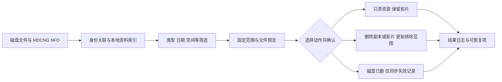

# 媒体库维护统一规划：NFO 补全、筛选清理、磁盘核对与停止收录

状态：用户已确认，第一期 A+B 已实现并完成本地测试验证；实际入口、行为和验证边界见 [使用说明](library-maintenance.md)。本文保留完整设计及第二期范围，第二期不属于当前交付。

## 1. 目标与建议

让用户可以先了解磁盘上有哪些影片、占多少空间，再根据 MDCNG 已刮削的资料筛选，选择只清图片或删除影片，并明确决定以后是否重新收录。

统一流程：**扫描磁盘 → 关联影片 → 读取 NFO → 更新本地资料索引 → 筛选 → 固定清理预览 → 确认执行 → 更新库关联及排除记录 → 查看结果或恢复**。

建议第一期完整交付这条流程，而不是只增加几个独立删除按钮。分类、发行日期筛选和删除后不再补回都属于第一期核心。

### 当前代码提供的基础

| 能力 | 当前事实 | 本次规划如何衔接 |
|---|---|---|
| 影片筛选 | `queries.py` 和 `pages/videos.tsx` 已支持分类、标签、女优、发行商、发行日期区间、时长、库、来源等 | 扩展同一筛选模型，并增加本地资料来源、磁盘状态、大小等条件 |
| 外部文件定位 | `strm_manage.py` 按 STRM 内容在收件及整理目录找回影片 | 作为身份关联的主要依据，增加扫描完整性和物理副本记录 |
| NFO | `writer.py` 能生成 NFO；当前未发现读取外部 NFO 并反向补全资料的流程 | 增加只读解析、来源记录及本地资料索引 |
| 缺失补回 | `restore_lost()` 受 `external_restore` 等设置控制；仅删除磁盘文件仍保留记录 | 新增缺失处理策略和明确的停止收录标记 |
| 删除源 | 屏蔽已删除的来源，但其他站点新源可以使影片再次入库 | 保留原含义，另设作品/库级停止收录，不复用源状态 |
| 批量预览 | `operations.py`、`operation_plans.py` 已有确认令牌、固定条目、分批执行及状态复核 | 扩展到物理文件清单、NFO 版本及清理结果 |
| 回收与归档 | `trash.py` 的残留回收和 `archive.py` 的删源归档用途不同 | 新增可追踪的清理批次及恢复入口，保留原有语义 |
| 空间清理 | 本会话已新增目录统计、extrafanart 全删/保留 N 张的本地实现，尚未提交部署 | 纳入统一入口和筛选范围；当前实现不能等同于完整维护功能 |

本次检查未在 `docs/`、`tests/` 找到实际 MDCNG NFO 样本。下面的字段兼容规则是设计目标，实施时需用目标版本生成的真实样本验证，不假定所有 NFO 都完全相同。

## 2. 用户入口

在现有「输出库与订阅」增加统一的「库维护」入口，进入后选择一个或多个库；影片列表和详情也可以把当前选择带入相同流程。

维护页面分为五个视图，复用现有任务页显示长任务进度：

1. **空间概览**：各库、一级目录、影片目录、文件类型占用，按大小排序。
2. **本地资料**：影片关联、NFO 解析结果、最后扫描时间、资料来源和冲突。
3. **筛选与清理**：筛选影片、选择文件类型及保留规则、生成预览。
4. **磁盘差异**：已移动、已缺失、待归库、目录不可达、未纳管、身份冲突。
5. **操作记录与恢复**：已删除、回收中、已停止收录、失败项和恢复入口。

页面始终明确当前选定的库和作用范围，不把“全库”“当前页”“全部筛选结果”混为一谈。

## 3. 磁盘扫描与影片关联

### 3.1 扫描范围和结果

- 扫描配置内的收件目录、外部整理目录；普通库扫描其输出目录。目录不接受任意接口参数临时扩权。
- 建立“一部影片可有多个物理副本”的记录，保留库、根目录、相对路径、主 STRM、多画质 STRM、NFO 和资源分类。
- 空间概览分别显示有效影片、未纳管内容、回收区和本服务可见的归档区。默认不把回收区、归档区作为活跃影片或再次清理的来源。
- 同一物理路径被多个配置引用时按规范化路径及文件身份去重；重复硬链接标记为共享，不将逻辑大小当成可实际释放空间。
- 扫描状态区分成功、部分失败、取消、目录不可达。只有完整且成功的对应目录扫描，才能提供“文件确实不存在”的证据。

### 3.2 关联优先级

1. 优先解析本服务已识别的 STRM 内容，按现有 slug、别名及来源映射关联作品。
2. 优先读取同名 NFO；无同名文件时，在确认一片一目录后兼容 `movie.nfo` 等布局。
3. NFO 中的番号和明确的编号型 `uniqueid` 用于核对。不能把任意 `uniqueid`、标题或文件夹名称直接当作可信番号。
4. 没有可识别 STRM、但 NFO 番号可唯一匹配时，列为待确认关联；多个可能作品、版本矛盾、多份不一致 NFO、共享目录都列为冲突。
5. 原生无码、普通版和 `-U` 版继续使用现有身份规则；NFO 的 genre/tag 不修改作品版本，不凭 “uncensored” 等宽泛标签合并记录。
6. 只有 NFO 或外来 STRM 的目录可以计入空间，并显示为未纳管。第一期不自动纳管、不将其直接纳入整片删除；用户确认关联后才能使用完整的清理流程。

共享目录只能按已明确归属的文件处理；不能因为选中一部影片就递归删除整目录。

## 4. 从 NFO 补全资料

### 4.1 默认行为

读取 MDCNG 已生成的 NFO，不启动重新刮削，不改写 NFO，不访问 NFO 内的图片/视频 URL。NFO 缺失时先显示缺失和已有源站资料；是否补刮交给用户在 MDCNG 处理。

使用独立的“本地刮削资料层”，保存最后一次成功读取的字段及来源。正常列表和详情可以展示本地有效资料；原有源站字段保留，不因刷新源站详情而丢失本地补全。

**NFO 更新不能直接触发已有规则归库、来源库重排或物理搬运。** 第一阶段现有归库规则继续使用原有数据语义。以后若要按本地资料自动归库，作为单独的配置和预览操作处理。

### 4.2 字段映射

| 本地字段 | 兼容的 NFO 来源 | 处理规则 |
|---|---|---|
| 标题/原始标题 | `title`、`originaltitle` | 保留两者，显示来源；不推导身份 |
| 番号 | `num`、明确类型的 `uniqueid` | 用于关联校验，冲突不覆盖数据库身份 |
| 发行日期 | `premiered`、`releasedate` | 解析合法日期；同一 NFO 两字段冲突需要标记，不能静默选一个 |
| 发行年份 | `year` 或完整发行日期提取 | 仅有年份时保留“年”精度，不伪造 1 月 1 日 |
| 类型/题材 | 多个 `genre` | 去首尾空格、去重；保留原始文字 |
| 标签 | 多个 `tag` | 与类型分开保存；不自动把全部标签并入类型 |
| 演员 | `actor/name`，可选 role/thumb | 名称用于本地筛选；没有站点演员 ID 时不伪造站点 ID |
| 厂牌/发行商 | `studio` 等样本确认字段 | 保留原字段语义；不随意把厂牌映射成其他商业实体 |
| 导演、系列 | `director`、`set/name`，兼容样本格式 | 第一阶段可展示及筛选 |
| 时长 | `runtime` | 明确 NFO 分钟与项目秒的换算，无效值视为未知 |
| 简介 | `plot`、可选 `outline` | 纯文本展示，不执行 HTML |
| 评分 | `rating`、`ratings/rating` 等 | 保留来源及量表；量表未经确认时不开放评分阈值删除 |

### 4.3 有效字段和冲突

- 查看某库时，使用该物理副本已校验的 NFO；字段非空且合法时优先展示。缺少字段时可展示源站字段，但明确标注来源。
- 涉及分类、日期的破坏性操作默认使用“可信 NFO 字段”。允许用户显式切换到“NFO 优先、缺项使用源站”，预览逐项显示实际来源。
- 多库、多副本的 NFO 不一致时保持各副本资料，不把类型取并集后当作全局事实。全局删除默认排除冲突作品，用户需先确认资料或统一副本信息。
- 类型、标签、演员使用本地命名空间和索引，不套用站点 slug/演员 ID。只做确定的空白和编码规范化；同义词映射另有显式配置，不进行猜测式归并。
- 每个字段/资料快照保留来源文件、文件指纹、扫描批次、解析器版本和更新时间。
- NFO 后来损坏、丢失或删除时，保留最后成功快照，状态改为过期/历史资料，不以空值覆盖；历史资料不默认参与现存影片的自动删除判断。
- 删除整部影片之前必须固化所用资料。影片在首次扫描前就已连同 NFO 删除的，无法恢复这份 NFO 的信息，只能依据已有数据库记录核对缺失。

### 4.4 读取边界

限制文件大小和解析工作量，禁止 DTD、外部实体和网络资源加载；采用安全 XML 解析方式。兼容明确的 XML 编码声明及 BOM，读取不改变原文件编码。解析失败、文件读取期间变化均保留旧快照并报告错误。

## 5. 筛选规则

这里的“按类型删除”拆成两个维度：**影片类型决定选哪些影片，文件类型决定删除这些影片的哪些文件**。

| 维度 | 第一阶段条件 |
|---|---|
| 范围 | 指定库/多个库、已关联的影片、普通版或 `-U` 版、番号及前缀 |
| 影片内容 | 类型、标签、演员、厂牌、系列、导演、标题关键词 |
| 时间 | 发行日期起止、发行年份、入库时间；发行日期不使用文件修改时间代替 |
| 属性 | 时长、已有来源/画质条件；来源和画质仍使用项目原有可信数据 |
| 文件状态 | 有/无 NFO、NFO 有效/过期/冲突、STRM 缺失、存在 extrafanart |
| 空间 | 影片目录大小、额外剧照占用、额外剧照张数、按占用排序 |
| 资料来源 | 只用可信 NFO，或明确启用源站补缺；是否只看待修复资料 |

规则语义保持明确：不同条件组默认 AND，同一组多个候选默认 OR；类型/标签增加“包含任一”“包含全部”“不包含任一”。未知值不会自动满足“早于某日期”“不包含某类型”等条件，只有显式勾选“包含未知”才纳入；未知和空集合在数据中保留区别。

日期区间包含两端。“早于 2018 年”表示发行年份小于 2018，或完整日期不晚于 2017-12-31。只有年份的记录可以参与年份筛选，不直接参与日精度条件。非法日期、字段矛盾和来源不明的日期默认不命中删除。

支持当前页选择、跨页显式选择、全部筛选结果和手动排除个别项。只有形成服务器端固定预览后，“全部筛选结果”才能用于删除；不能在执行期间持续用动态条件扩大范围。

### 示例

- 类型包含 A 或 B，发行日期早于 2018 年，范围为「其他」库：预览整片删除并禁止返回该库。
- 所有库中 extrafanart 超过 50 MB 的影片：每部保留前 3 张，只删额外剧照。
- 某演员的影片，发行年份 2010–2015：先看 NFO 来源及完整命中列表，排除几部保留作品后删除。
- 显示没有有效 NFO 的影片，先补全资料；不把“没有资料”自动等同于“可以删除”。

以上类型名称和阈值仅用于说明，不是预置的自动删除规则。

## 6. 清理动作及后续收录

| 用户动作 | 文件影响 | 数据库变化 | 后续收录 |
|---|---|---|---|
| 清理额外剧照 | 只删除选中影片的 extrafanart 图片，全删或自然排序保留前 N 张 | 更新资源统计，保留影片与输出关系 | 正常保留影片；本项目不主动重新下载 extrafanart |
| 按资源类型清理 | 在明确选定类型内删文件，如主封面、缩略图、NFO、预告片 | 保留 STRM 与入库关系，记录缺失及本地清理策略 | 自管输出需遵守本库的资源禁补策略；外部刮削器另行配置 |
| 删除当前库的影片副本 | 清理选定库内已关联的收件及整理副本；其他库不受影响 | 移除完成清理的库关联，保留影片身份 | 默认增加该库排除记录，避免规则、来源库或订阅再次加回 |
| 删除影片并全局停止收录 | 预览并清理该版本在所有已配置库中的已关联副本 | 清除已完成的输出关系，保存全局排除记录 | 所有站点、所有库跳过本版本；另一版本不受牵连 |
| 磁盘已删后的记录核对 | 不再执行物理删除 | 确认缺失后移除失效库关联；可明确选择库级或全局排除 | 按已选排除范围阻止补回 |
| 删除来源 | 保持项目现有来源屏蔽/归档逻辑 | 修改来源状态 | 其他新源仍可正常工作；不等于停止收录 |

默认不提供“一键清空作品身份记录”的普通入口：只剩空库记录而没有停止收录记忆，会再次导入。作品和来源资料是防止重复收录、追溯及解除操作的依据。

资源类型不能简单按扩展名粗删：根目录的 fanart/poster/thumb 与 extrafanart 分开识别；字幕、真实视频、预告片和未知文件分开列出。第一期默认不勾选 NFO、主封面、字幕或实体媒体。完整影片目录仅在确认独占且文件归属完整时处理；出现不明文件、其他影片或实体媒体时阻止整目录动作，先明确范围。

“删除文件但允许以后补回”作为明确的高级选择，预览提示可能再次收录；正常主动淘汰默认禁止返回选定范围。

NFO 优先级仅影响资料读取，不是对 MDCNG 的控制。MDCNG 重刮仍可能补图、补 NFO，需要在其设置中限制对应下载；本服务不能承诺阻止外部工具写盘。

## 7. 回收区、永久删除与恢复

- 整片删除默认进入有批次记录的回收区，推荐保留 7 天，沿用配置但在本次确认页显示实际天数。配置为 0 时必须明确展示“永久删除”，不能把它呈现为可恢复。
- 额外剧照以释放空间为目的，可直接永久删除，仍需要清晰确认；也可选择暂存回收区。其他资源采用相同的显式处置选择。
- **同盘移入回收区不会立即释放磁盘空间。** 分别展示“从媒体库移除的大小”“回收区占用”“永久移除的逻辑大小”和文件系统可用空间变化，后者只作观测，不把并发写盘后的差值全归因于本任务。
- 回收区使用唯一批次和保留原相对路径，保存文件及库关联清单。不能只调用现有删除 STRM 再回收残留的逻辑，否则恢复时缺少完整影片文件。
- 默认选用根目录内同文件系统的回收位置；如配置跨盘归档，提前校验可用空间和挂载，不能假设移动只需改名。
- 恢复前预览冲突，原路径已存在时保留两侧并跳过，不覆盖。恢复文件和库关联后，显式解除本次操作产生的排除；不解除其他操作或用户后来建立的排除。
- 已永久删除的文件不能承诺恢复。解除停止收录只恢复收录资格，重新抓取/刮削需要另行发起，不等于原文件恢复。
- 取消任务只停止后续项，不自动撤销已执行的文件操作。失败和部分完成均提供逐项结果、重试未完成项及可恢复项入口。

## 8. 磁盘与数据库同步策略

文件是否存在、来源是否可用、是否禁止收录是三种独立状态，不共用 `videos.status`。

| 磁盘情况 | 默认行为 |
|---|---|
| STRM 被移动或改名 | 按内容关联并更新路径，不退库 |
| 只删了 extrafanart、NFO 或封面 | 标记资源缺失/主动清理，不把整片当作删除 |
| 从未写出、等待归库 | 保留待归库状态，不作为主动删除候选 |
| 一个副本缺失、另一个还在 | 更新该副本状态；不由此推导全局删除 |
| 根目录离线、读目录失败、挂载身份异常 | 显示不可达/未知，保留上次记录，不产生缺失退库结论 |
| 成功扫描后发现曾输出的 STRM 真正缺失 | 列入待确认缺失，按该库配置选择补回或人工核对 |
| 确认用户主动删除 | 清理相应库关联，持久化排除，以后补回路径也遵守 |

每库建议增加 `missing_policy`：`restore`（兼容现有全局设置）和 `review`（发现缺失先等待确认，期间不自动补回）。第一期不提供“扫不到就自动永久删除数据库”的策略。

对经常手动删片的库，建议在建立完整基线后主动切换到 `review`。抓取、核对和自动归库在首次发现缺失时就必须遵守该策略，不能等下次定时扫描才生效，避免在人工确认前被补回。

整库突然为空须作为独立的“整库清空”确认；没有稳定可验证的挂载身份时只报告，不能依据一次空目录就确认删除。扫描中断不能将未扫描到的部分标为缺失。

全局停止收录默认要求相关配置根可核对；其他库仍有文件时预览列出全部副本。用户只选择处理当前库时，不扩大物理删除范围，也不隐式建立全局排除。

## 9. 预览、执行与一致性

预览必须包含以下可核对内容：

- 条件及数据来源、选定库、影片数、物理副本数、文件数、文件类型、预计空间、实际处置方式、禁收范围。
- 可分页查看完整影片及文件清单，每项显示命中理由、发行日期/类型及所依据的 NFO 路径，不只提供少量随机样本。
- 已排除的未知日期、冲突 NFO、未纳管、共享目录、不可达目录等数量和原因。
- 固定影片 ID、版本、资产 ID、文件清单与指纹、资料版本、规则版本和配置范围。重新扫描或修改条件须重新预览。

执行时按影片/副本分组处理：

1. 复核范围、对应目录、NFO 和文件指纹；使用身份和变更时间等信息检查文件替换，不依赖路径存在这一项判断。
2. 在数据库持久化本次正在清理的保护状态和执行意图，阻止并发抓取、补回、规则归库继续写入目标。
3. 写入文件操作日志后逐项移入回收区或删除；按清单逐项核对，不在执行时重新扩展目录递归范围。
4. 根据实际文件结果更新资产与库关联，仅在该副本所需文件操作完成后完成对应记录变更；更新排除状态及执行游标。
5. 错误记录到对应项，跳过变化项并继续其他已确认组；原计划不存在的新文件不删除，目录出现额外文件则保留目录并报告。

文件系统与 SQLite 不能跨介质原子提交，必须靠意图日志和幂等恢复衔接。重启时根据源文件、回收目标及执行阶段核对，不把“已移动但未记账”当成需要重新补回。

部分失败期间保留执行保护，并显示“清理未完成”；重试或放弃都先按实际已完成项收敛状态，不因取消就解除已删影片的禁收。普通源站刷新、别名归并及版本整理不得抹掉排除记录；归并时迁移并合并对应排除范围。

应用内文件变更使用现有互斥机制，按有限批次持有。外部 MDCNG 不受此锁控制，执行前应暂停目标目录写入；预览后的外部变更需要被检测并跳过，不承诺跨进程无条件原子删除。

## 10. 后端模块与数据组织

继续使用 FastAPI、SQLite、现有 jobs/tasks、预览确认和 React 组件，不另起任务系统。建议拆分职责：

| 模块 | 职责 |
|---|---|
| 磁盘资产扫描 | 目录健康、完整扫描批次、物理副本、类型占用和文件指纹 |
| NFO 解析与资料投影 | 安全解析、身份核对、字段映射、来源和冲突；可独立测试 |
| 维护筛选 | 将已有 `VideoQuery` 条件与本地资产/NFO 条件统一编译为白名单查询 |
| 收录排除 | 统一判断全局/库级排除与正在清理状态，所有写入入口复用 |
| 清理计划与执行 | 冻结文件清单、确认、日志、断点、处置和恢复 |
| 页面与 API | 空间概览、资料差异、筛选、完整预览、操作记录 |

建议新增以下有限的数据结构，最终 DDL 在实施时按实际查询最小化：

- `library_assets`：一个已识别物理副本一行；记录库、根、相对路径、影片 ID、最近成功扫描、文件状态、分类型大小、NFO 原始字段/来源快照及可索引的日期/时长字段。
- `asset_facets`：本地类型、标签、演员等多值索引，独立于源站 `video_facets`，防止名称和 ID 混用。
- `collection_exclusions`：影片身份、全局或库级范围、启停状态、原因、创建操作；同一范围唯一。普通版和 `-U` 版独立；作品身份记录继续保留。
- 文件清理策略：按库及影片副本记录主动清除的资源类型，供自管写出/核对过程识别，避免本服务立刻重新下载被清理的封面等。
- `cleanup_files` 或等价持久化文件日志：关联现有预览条目和任务，记录原路径、指纹、回收路径、动作、阶段及结果；不把百万文件塞进一条 jobs.state JSON。

扫描批次、任务摘要继续复用 jobs；影片级固定范围复用 operation_items。已有 `storage-plans` 清单需要明确版本及兼容处理：旧任务只按旧清单完成，不允许在确认后换成新解释器扩大范围。

迁移默认不建立任何禁收，不自动改变当前补回策略。NFO 导入先写本地资料层，旧数据库和 API 保持兼容；当前磁盘状态与资料展示切换可分步启用。迁移前备份数据库，并用旧数据升级测试校验。

### 必须接入排除检查的路径

列表/订阅抓取、详情回填触发输出、指定影片导入、自动及手动补源、前缀补源、规则归库、来源库归并、手动加入、核对补回、重写、恢复删源，以及已经排队的相关任务执行阶段。

源站资料允许按既有需要保留，但禁收状态不能被 `_update_work()` 的 active 恢复、其他站点新源或去重合并解除；仅在用户明确解除时恢复收录资格。

## 11. 性能、任务与可观测性

- 首次完整扫描后台执行；之后按文件身份、大小和修改时间增量解析 NFO。读取前后检查稳定性，发生变化则重试；提供强制重读，处理保留时间戳的文件替换。
- 列表和筛选读取数据库索引，不在每次页面请求中递归扫描磁盘或解析 XML。
- 大目录遍历、文件清单读写采用流式批次；默认少量磁盘工作线程，避免数十个爬取 worker 同时遍历同一存储。
- 清理支持暂停、恢复、取消；取消不撤销已完成项。记录扫描/解析/匹配/清理/恢复各阶段进度、失败原因和最后处理路径。
- 结果分别报告已移入回收区、已永久删除、文件已不存在、文件变化跳过、身份冲突、权限失败；不把“任务已结束”展示成“全部成功”。
- 扫描结果保留最近成功基线，失败批次不覆盖。清单和日志的保留/删除遵守关联任务及恢复需求，防止维护日志自身无限增长。
- 性能验收使用十万影片、百万文件级合成目录及抽样真实库；记录扫描耗时、峰值内存、筛选延迟与取消响应，不用小样本测试宣称大库性能已达标。

## 12. 实施顺序与验收

### 第一期 A：可信扫描和 NFO 筛选

交付资产扫描、NFO 解析及来源状态、有效资料展示、类型/日期等筛选、空间概览、缺失差异页。可预览命中结果；新整片删除入口在后续阶段就绪前保持不可执行。

验收：改名能找回；NFO 日期/多值类型与样本一致；未知值不误命中；源站刷新不丢本地资料；普通版和 `-U` 版不串；扫描不可达不产生虚假的缺失列表。

### 第一期 B：完整清理和停止收录

交付按筛选清理 extrafanart/资源类型、整片清理、库级与全局排除、每库 review 策略、完整文件预览、执行日志、回收恢复和断点续跑。现有额外剧照功能收敛到统一入口。

验收：选“类型 A + 2018 年前”只处理冻结范围；日期未知和 NFO 冲突默认排除；新抓到其他站点来源也不能回库；只清图不退库；删除当前库副本不动其他库；回收与永久删除空间统计不同；恢复不覆盖冲突文件。

两个阶段合起来才是满足本轮需求的第一期完整版本；不能只完成 A 就宣布删除能力交付。

### 第二期：便利能力，暂不作为首期前置条件

可保存筛选模板、定时只读盘点和生成建议清单、标签别名配置、可信评分筛选及更多资源识别。自动执行整片删除不默认开启，也不因“保存模板”自动创建清理计划。

直接调用 MDCNG API 触发补刮、自动修改其配置，以及同步 Emby/Jellyfin 的数据库不在首期范围。之后有需要再根据目标版本、权限和独立授权设计。

### 关键测试矩阵

| 场景 | 预期 |
|---|---|
| 同名 NFO、movie.nfo、多 actor/genre/tag、编码声明 | 正确解析；歧义或坏格式不默默采用 |
| 日期缺失、只有年份、日期冲突、非标准评分 | 按精度/来源处理；不凭猜测筛选删除 |
| NFO 更新、损坏、丢失及预览后被重写 | 缓存有来源，旧值可追溯，执行跳过变化项 |
| STRM 改名/移动、多画质、别名、多个库副本 | 关联正确，计数不重复，不扩大版本或库范围 |
| 部分目录无权限、根目录离线、整个挂载为空 | 未验证范围保持未知，不退库或大批禁收 |
| 共享目录、链接、未知文件、实体媒体 | 不越界、不误删邻片，整目录删除有明确限制 |
| 全部筛选结果确认后新增影片、改变条件 | 仅处理原冻结目标 |
| 清理与抓取/归库并发、进程中断、重复确认 | 不重建已删文件，不重复副作用，可恢复执行 |
| 保留 0/3/N 张、fanart2/fanart10、删除主图/NFO | 类型归属和自然排序正确，主动清理策略生效 |
| 只删当前库、全局禁收、新站新源、去重合并 | 排除范围稳定，不因身份整理被清除 |
| 回收后恢复、原路径冲突、回收过期、永久删除 | 明确可恢复边界，不覆盖现有文件，不承诺不可实现的恢复 |

## 13. 推荐默认值及实施前核实项

推荐默认：NFO 可信字段用于破坏性筛选；未知/冲突不选中；整片删除先回收；extrafanart 默认保留 3 张；删除副本禁止返回当前库；用户明确选择“全局停止收录”时覆盖该版本全部已配置库；现有库继续原补回策略，主动启用 review 的库才改变行为。

实施前应获取目标 MDCNG 生成的代表性 NFO（普通版、`-U`、无码或 FC2、缺日期、多演员/类型）及实际路径布局，用来确认标签、日期和版本关联。可以在有授权的目标目录只读抽样；不应先登录生产 MDCNG 或修改其刮削设置。

部署验证按“数据库迁移与只读扫描 → NFO 资料核对 → 少量测试库预览 → 可恢复清理与恢复 → 明确选定真实范围”推进。该规划阶段不执行媒体删除、不调整现有补回配置、不部署。
